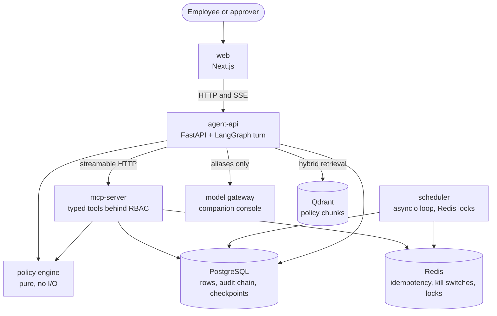

# AI Helpdesk with Governed Access

An IT helpdesk agent that performs the fix instead of describing it. Employees
ask for access in plain language; the system decides, grants, or escalates, and
every decision is policy-cited, permissioned, time-bound and auditable.

## Problem statement

Access requests are the highest-volume ticket in most IT queues and the one
nobody wants to automate. The work itself is small: read the request, find the
policy that covers it, check the person is allowed it, grant it for a bounded
period, write down why. The reason it stays manual is that being wrong is
expensive in one direction. Over-granting is invisible until an audit or a
breach, and the person who approved it cannot remember the reasoning six months
later.

The obvious application of a language model makes that worse. A model that can
call a mutation API is a model that can grant production database access
because a sentence was phrased confidently. The interesting problem is not
getting a model to act; it is building a system where the model interprets and
something deterministic decides, so that speed comes without the failure mode
that made the queue manual in the first place.

This system answers in one turn what a helpdesk answers in a day, and it can be
argued with afterwards: every grant names the rule that allowed it, the person
who approved it, and the date it dies.

## Demo

Video: not yet recorded. The walkthrough covers the five flows the end-to-end
suite drives, in one take against the real stack.

Until it exists, `make e2e` is the demo: it drives those flows in a real
browser against Postgres, Redis, Qdrant, the MCP server, the policy engine and
the built web app, with only the model replaced by a stub gateway.

## Architecture diagram



The model is reachable from one service, through a gateway, under an alias. No
service in this repository names a provider model. Every write on a user's
behalf arrives through the MCP server, which authorizes the call against the
caller's token before the handler runs.

Four diagrams, all Mermaid sources rendered by GitHub rather than exported
images, so the picture and its source cannot disagree:

- [docs/diagrams/architecture.md](docs/diagrams/architecture.md), the one above
- [docs/diagrams/request-lifecycle.md](docs/diagrams/request-lifecycle.md), one
  turn from sentence to reply
- [docs/diagrams/grant-lifecycle.md](docs/diagrams/grant-lifecycle.md), how
  access ends
- [docs/diagrams/approval-lifecycle.md](docs/diagrams/approval-lifecycle.md),
  what a paused turn waits for

## Guarantees

Seven claims, each linked to the test that fails if it stops being true.

1. **No direct mutation.** The model plans; typed tools act. Every tool call is authorized against the caller's token at the transport before a handler runs. Proof: [test_matrix_expectation_holds_through_the_transport](services/mcp-server/tests/test_mcp_rbac_matrix.py)
2. **Tenant isolation.** Every read and write is bound to the tenant on the token. Another tenant's row is not forbidden, it is absent. Proof: [test_other_tenants_id_is_not_found](packages/helpdesk/tests/test_repository.py)
3. **Mandatory expiry.** Access is granted for a bounded period, capped by the access class, and the cap is applied at grant time rather than promised. Proof: [test_the_grant_expires_exactly_one_class_cap_after_granted_at](packages/helpdesk/tests/test_access_execute.py)
4. **Segregation of duties blocks, and cites.** A conflicting combination is refused with the identifier of the rule that refused it, not with a generic denial. Proof: [test_classification_accepts_a_sod_conflict_reason_with_an_id](packages/helpdesk/tests/test_policy_decision.py)
5. **A cited answer or none.** Below the retrieval threshold the system refuses and offers a ticket instead of answering from the model's memory. Proof: [test_a_best_cosine_just_below_the_threshold_refuses](packages/helpdesk/tests/test_rag_refusal.py)
6. **Hash-chained audit.** Each event carries the hash of the one before it, so an edited, deleted or relabelled row breaks verification. Proof: [test_relabelling_a_chain_onto_another_tenant_is_detected](packages/helpdesk/tests/test_audit_writer.py)
7. **Idempotent retry.** A repeated call with the same key returns the first result and runs no second effect, so a timeout is safe to retry. Proof: [test_replay_returns_the_stored_response_without_running_the_effect](packages/helpdesk/tests/test_idempotency_guard.py)

A guarantee whose link rots fails the suite: the README is parsed by
`packages/helpdesk/tests/test_docs.py`, which opens each target and looks up
each named test.

## What broke and how I fixed it

- **A key validator accepted a trailing newline.** Pydantic's `pattern=`
  matches anywhere in the string, so a value ending in a newline satisfied a
  pattern anchored only at the start. Fixed by validating with a full-string
  match in an explicit validator, and by adding a trailing newline, a carriage
  return and a space to every rejection table.
- **The refusal threshold refused everything.** The number was written against
  a similarity score and measured against a fused rank score on a completely
  different scale, so almost no answer cleared it. The fix was to measure the
  threshold on the dense cosine while the fused score keeps ordering the page,
  recorded in [docs/adr/0009-refusal-threshold-is-measured-on-dense-cosine.md](docs/adr/0009-refusal-threshold-is-measured-on-dense-cosine.md).
- **A resumed turn would have granted twice.** Approval executes the grant in
  the same transaction as the last filled seat, so the paused conversation had
  nothing left to execute when it woke up. Fixed by having a resumed run
  compose its reply from the decision recorded on the row and make no tool call
  at all, recorded in [docs/adr/0013-a-resumed-run-composes-and-never-re-executes.md](docs/adr/0013-a-resumed-run-composes-and-never-re-executes.md).
- **A turn that ran out of budget told the user nothing had happened.** The
  templated refusal was sent over a turn that had already filed a request, so
  the reply and the audit log disagreed. The fix routes a spent budget on what
  the turn has already done: refuse when there is nothing to report, compose
  when there is.
- **Two paths hashed the same object into different bytes.** The idempotency
  fingerprint and the audit chain each serialised their payload, and key order
  differed between them, so a replay looked like a conflict. Fixed by making
  both call one canonical serialiser, pinned by a test whose keys sort
  differently in Python than in the database.
- **A client was given a timeout and its sibling was not.** One call could hang
  for ever while its neighbour gave up in seconds. Fixed by treating a timeout
  as an obligation on every client the code constructs, connect half and read
  half, asserted on the client object rather than on the constant.

## Design decisions

Non-obvious choices are recorded as decision records in
[docs/adr/](docs/adr/). Twenty-two of them so far; these are the ones that
shape the product.

- **LangGraph orchestrates and decides nothing.** It owns the node sequence,
  the turn state, the checkpoint and the approval pause. It never owns the
  decision, the mutation, identity or the audit record.
  [0001](docs/adr/0001-langgraph-orchestration-only.md)
- **The policy engine is pure.** No input or output, no imports from models or
  services, table-driven, and held at 100% coverage. The decision a tool
  enforces is the decision the reply explains.
- **The checkpoint thread is the session.** The request a paused turn waits on
  rides on the state rather than in the key, because the request does not exist
  when the run starts.
  [0012](docs/adr/0012-the-checkpoint-thread-is-the-session.md)
- **A resumed run composes and never re-executes.**
  [0013](docs/adr/0013-a-resumed-run-composes-and-never-re-executes.md)
- **The stream carries the checked reply.** Tokens are slices of a reply that
  already passed the contradiction check, because a token on the socket cannot
  be taken back.
  [0014](docs/adr/0014-the-stream-carries-the-checked-reply.md)
- **The scheduler is a loop with Redis locks**, not a job framework, so every
  sweep is callable from a test with a session and a fixed instant.
  [0015](docs/adr/0015-the-scheduler-is-a-loop-with-redis-locks.md)
- **The approval queue lives in PostgreSQL**, next to the rows it decides
  about, so a decision and its effect share one transaction.
  [0004](docs/adr/0004-approval-queue-lives-in-postgres.md)
- **Model access is a gateway with aliases.** Code names `agent-default` or
  `agent-strong`; the mapping to a provider model lives outside this
  repository, with the budgets and the traces.
  [0010](docs/adr/0010-model-client-is-its-own-package.md)

## Failure modes

What the system does when a dependency is gone, rather than what it does when
everything works.

| Failure | What the system does | What the user sees |
|---|---|---|
| Model gateway down | Readiness turns red; no turn is started. Tool calls, policy decisions and the audit chain are unaffected. | A plain failure message. Nothing is half-done, because nothing ran. |
| Qdrant down | Retrieval fails, which is below the citation threshold by construction. | A refusal offering a ticket, never an uncited answer from the model's memory. |
| Redis down | Idempotency keys cannot be claimed and kill switches cannot be read, so every mutating tool refuses before its effect. | A typed failure on write paths; reads keep working. |
| Model returns garbage | Structured output fails schema validation and is retried once, then handled as a failed turn. The decision-word check catches a reply that contradicts the tool results. | A refusal, or a reply regenerated once and then replaced by a fixed template. |
| A tool call timeout mid-execution | Every client carries a connect and a read timeout. The turn records the failed result and composes from what actually succeeded. | An honest partial answer naming what was done and what was not. |
| Two approvers act at once | The seat write is a single transaction with a row lock, so the second decision finds the seat filled. The grant executes once. | One approval recorded, one told the seat is already decided. No double grant. |

## Numbers

Measured against the golden set and the load smoke run, filled in as the
harness runs. An unmeasured cell says so rather than showing a plausible
number.

| Metric | Result |
|---|---|
| Decision accuracy | not yet measured |
| Refusal precision and recall | not yet measured |
| Citation accuracy | not yet measured |
| Cost per turn | not yet measured |
| p95 latency per chat turn | not yet measured |

`make eval` runs the golden set against the product and compares it to a
committed baseline. `make load-smoke` drives 20 concurrent chat sessions for
five minutes against the real gateway and prints p50 and p95 per turn. Both
need a real gateway; a figure taken from the stubbed run would measure this
repository's own overhead and nothing a reader cares about.

## At 10x and 100x

At ten times this load, nothing in the design moves. The turn is bounded by the
model call, the services are stateless behind their stores, and the scheduler
claims each job with a Redis key so a second instance is safe. The first thing
to feel it is Postgres, and the first fix is ordinary: connection pooling and
read replicas for the audit search, which is the only query that scans.

At a hundred times, three things break in a way configuration does not fix.

The audit chain is sequential per tenant, so appends within one tenant
serialise. That is the price of a chain that can be verified, and the way out
is batching within a transaction, not parallel appends.

Retrieval over one Qdrant collection per tenant stops being free when tenants
are counted in thousands; collections become shared with a tenant filter, and
the isolation argument moves from the collection name to the filter, which is a
weaker argument that needs its own tests.

The scheduler's one-loop-per-cadence design sweeps every tenant inside a single
job run. At a hundred times the tenants, a sweep outlives its own window, and
the job has to become a queue of per-tenant units with a worker pool.

None of these is speculative work today. They are written down so the person
who hits them knows which part of the design was chosen for clarity and which
part was chosen because it scales.

## Works council note

In several European jurisdictions, a system like this needs the agreement of
the employee representative body before it goes anywhere near real staff. The
objection is never automation; it is monitoring. A tool that logs what each
employee asked for, and when, is a behavioural record whether or not anybody
intended it as one.

Three properties exist for that conversation.

Telemetry carries the session and the tenant, never user identity. Traces,
metrics and logs cannot be joined back to a person.

The audit log records decisions about access, not behaviour. It answers "who
holds this, since when, approved by whom, until when", which is what an auditor
asks. It is not a transcript of what anybody typed.

Every decision is contestable, because it cites the rule it applied and the
person who approved it. An employee can be told why, which is the practical
difference between an automated decision and an unexplainable one.

## Quickstart

```
docker compose up -d
uv sync
uv run alembic upgrade head
uv run python scripts/seed.py
make run
```

The seed is deterministic and safe to re-run. Logins for every seeded role are
in [docs/demo-accounts.md](docs/demo-accounts.md); the data is invented and the
email domains are reserved `.example` addresses.

Gates, in increasing order of cost:

```
make lint typecheck     # seconds
make test               # the suite, needs the compose stack up
make verify             # everything, including the web build
make e2e                # five flows in a real browser; resets the database
```

## Integration path to a real directory

This repository ships a simulated directory: users, departments, memberships
and grants live in its own tables, so the demo runs with no external system.
Everything above them talks to a port of seven methods, not to those tables.

An adapter for Entra ID, Okta or a SCIM endpoint is one class implementing that
port. Reads answer from the upstream directory, and `apply_grant` and
`revoke_grant` become calls to it. The policy engine, the RBAC matrix, the
approval chain and the audit chain do not change, because none of them knows
where a membership came from.

### Use it with your own policies

The policy corpus is a folder, not a fixture. Point `POLICY_DIR` at your own
and re-ingest:

```
POLICY_DIR=/srv/company-policies
make ingest TENANT=your-tenant-slug VERSION=v1
```

The layout is `{tenant}/{version}/{file}`; the shipped `policies/` folder is a
demo corpus, not a dependency.

The five things an adopter changes first are listed in
[CUSTOMIZING.md](CUSTOMIZING.md), and the port is walked through method by
method in [docs/directory-adapter.md](docs/directory-adapter.md).

Companion project:
[ai-operations-console](https://github.com/developermusa/ai-operations-console),
the gateway, evaluation harness and observability layer this system runs on.

License: Apache-2.0
