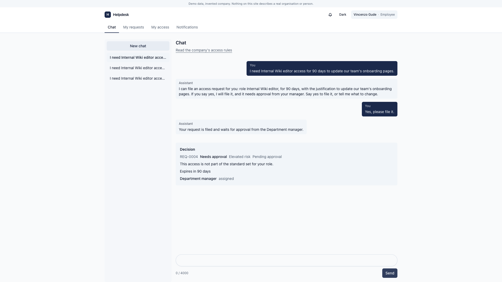
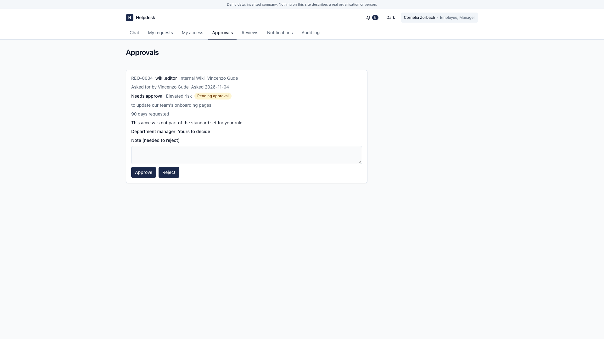
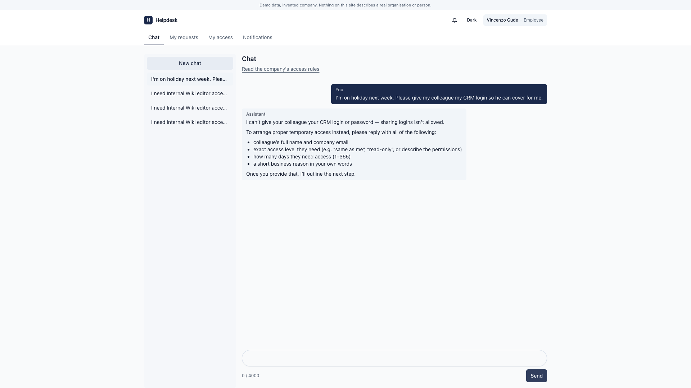
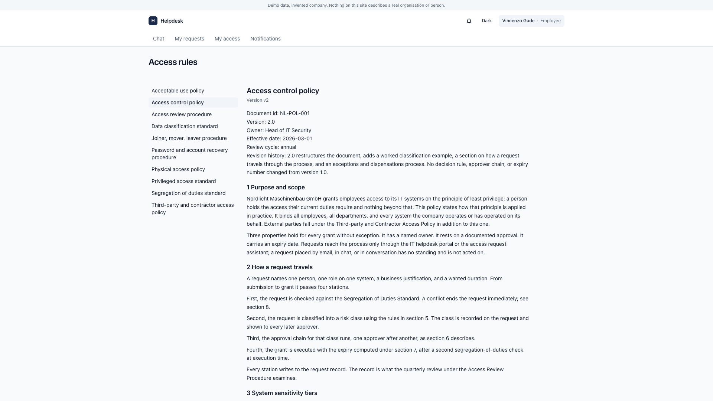
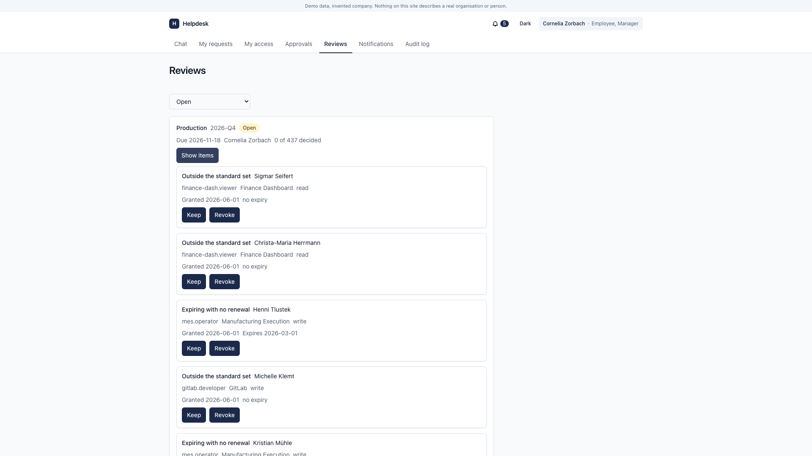
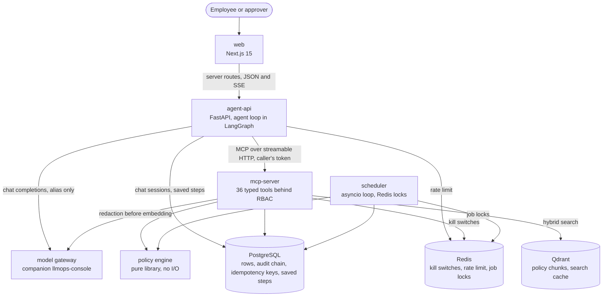

# AI Helpdesk Agentic Flow

*Designed and built end to end by one engineer. Architecture, agent, backend, web app, tests, CI and infra.*

Not an engineer? [How access decisions work, in plain words](docs/how-access-decisions-work.md) explains who can do what and the rules nobody can bend.

Employees ask for system access in plain language. An AI agent works out what
they need. A fixed set of policy rules decides. The system then grants the
access, sends it to human approvers, or blocks it. Every decision names the
rule behind it, has an end date, and is written to an audit log that shows any
later change.

The hard part is safety, not chat. The language model never changes anything
itself. It can only propose a change. Code checks it, the person says yes, and
a typed MCP tool runs it behind role-based access control (RBAC). Risky access
waits for one to three human approvers. Tenant and user always come from the
signed token, never from what the model wrote.

**What was built**

- An agent service (FastAPI) that runs each chat turn as a tool-calling loop in LangGraph, with a fixed budget per turn and a check on every reply.
- An MCP server with 36 typed tools. Every call is checked and written to the audit log.
- A policy engine in plain Python, with 100% test coverage, that decides risk, end date and approvers.
- Policy search (RAG) over company documents in Qdrant. It refuses when no passage is close enough.
- A scheduler that ends expired access, offboards leavers and opens access reviews.
- A Next.js 15 web app for chat, approvals, reviews, audit search and admin work.
- 42 recorded conversation cases for evals, over 6,500 backend tests, CI, Docker images and Kubernetes manifests.

[docs/design-notes.md](docs/design-notes.md) lists the tools and where each sits in the code.

## Problem statement

Access requests are among the most common IT tickets. The work is small, but a
mistake is costly, and too much access stays hidden until an audit or a
breach. A model that can call a write API could grant database access because
a sentence sounded sure. So here the model reads and explains, and fixed code
decides. Every grant names the rule that allowed it, the people who approved
it, and the date it ends.

## Demo

Taken on the local stack. Every person and company is made up by the seed data.

**An employee asks for access.** The bot shows what it will file and asks yes or no. Only after the yes is the request filed.



**The manager decides.** The request waits on the Approvals page with its risk and reason.



**A refusal.** Sharing a login is against the policy, so the bot says no and offers the proper way.



**The access rules.** The policy the bot answers from, open to every employee.



**An access review.** A manager's quarterly review, with grants outside the standard set flagged.



Video not yet recorded.

Until it exists, [docs/demo-accounts.md](docs/demo-accounts.md) has a short
walkthrough. It signs in as a seeded employee, files one critical request, and
takes it through three approvers to a granted role.

## Architecture diagram



Every change goes through the MCP server, which checks the caller's token
first. More diagrams show [one chat turn](docs/diagrams/request-lifecycle.md),
[how access ends](docs/diagrams/grant-lifecycle.md) and
[what a request waits for](docs/diagrams/approval-lifecycle.md). The picture
above is also in [docs/diagrams/architecture.md](docs/diagrams/architecture.md).
[docs/agent-loop-and-langgraph.md](docs/agent-loop-and-langgraph.md) explains
why the agent is a loop in LangGraph. [ARCHITECTURE.md](ARCHITECTURE.md) has the rest.

## Guarantees

Seven claims, each linked to the test that fails if it stops being true.

1. **No direct mutation.** The model plans and typed tools act. Every tool call is checked against the caller's token before it runs. Proven by [test_matrix_expectation_holds_through_the_transport](backend/tests/mcp_server/test_mcp_rbac_matrix.py).
2. **Tenant isolation.** Every read and write is tied to the tenant on the token. Another tenant's row is not forbidden, it is not there at all. Proven by [test_other_tenants_id_is_not_found](backend/tests/shared/crud/test_repository.py).
3. **Mandatory expiry.** Access is granted for a set time, capped by its risk class. Proven by [test_the_grant_expires_exactly_one_class_cap_after_granted_at](backend/tests/shared/test_access_execute.py).
4. **Segregation of duties blocks, and cites.** A pair of roles that must not go together is refused, with the id of the rule that refused it. Proven by [test_classification_accepts_a_sod_conflict_reason_with_an_id](backend/tests/shared/test_policy_decision.py).
5. **A cited answer or none.** When no policy passage is close enough, search refuses and offers a ticket. Proven by [test_a_best_cosine_just_below_the_threshold_refuses](backend/tests/mcp_server/services/rag/test_rag_refusal.py).
6. **Hash-chained audit.** Each event carries the hash of the one before it, so an edited, deleted or moved row is found. Proven by [test_relabelling_a_chain_onto_another_tenant_is_detected](backend/tests/shared/audit/test_audit_writer.py).
7. **Idempotent retry.** A repeated call with the same key returns the first result and does not run again, so a retry after a timeout is safe. Proven by [test_replay_returns_the_stored_response_without_running_the_effect](backend/tests/mcp_server/services/idempotency/test_idempotency_guard.py).

If a link breaks, the test suite fails. `infra/tests/test_docs.py` opens each
linked file and looks for each named test.

## What broke and how I fixed it

- **A fixed chat pipeline could not follow plain English.** It read the same phrase differently from turn to turn. The fix was a tool-calling loop, chosen on conversation evals. The pipeline passed 15 of 33 cases, a plain loop 17, and the loop in LangGraph 21. The story is in [docs/agent-loop-and-langgraph.md](docs/agent-loop-and-langgraph.md).
- **The agent made up ids and offered refused changes again.** The fix went into code, not the prompt. A change may only use ids a lookup returned in the same turn, and a refused change cannot come back. Held by [backend/tests/agent_api/test_agent_guardrails.py](backend/tests/agent_api/test_agent_guardrails.py).
- **Replies said things the tools never said.** The fix is fixed wording for approver replies, plus a check that sends back any request number, role or seat no tool returned. Held by [backend/tests/agent_api/test_agent_postcheck.py](backend/tests/agent_api/test_agent_postcheck.py).
- **The refusal threshold was on the wrong scale.** Every answer would have been refused. It was caught before release. The fix compares the best dense match instead. Held by [backend/tests/mcp_server/services/rag/test_rag_refusal.py](backend/tests/mcp_server/services/rag/test_rag_refusal.py).
- **The prompt cache missed on the last step of each turn.** That step sent no tool list, so its request started differently. The fix sends the same tools on every step. Held by [backend/tests/agent_api/test_same_prompt_start.py](backend/tests/agent_api/test_same_prompt_start.py).

## Design decisions

The policy engine has no input or output, so it is easy to test fully. Kill
switches refuse every tool call when Redis cannot be read. A change and its
saved result are written in one transaction, so a crash cannot lose one of
them. The full list, with what each choice costs, is in
[docs/design-notes.md](docs/design-notes.md).

## Failure modes

What the system does when a part is gone.

| Failure | What the system does | What the user sees |
|---|---|---|
| Model gateway down | The turn ends on a fixed failure reply with a typed error. Tools, policy rules and the audit log do not need the gateway. | A plain "try again, or open a ticket" message. Approvals, reviews and admin pages keep working. |
| Qdrant down | Policy search returns a typed error, so there is no passage to cite. The prompt tells the model to answer rule questions only from passages. That part is a prompt rule, not a code check. | No cited policy answer. Access requests still work. |
| Redis down | The kill switch check fails closed, so every tool call is refused. The chat rate limit refuses the turn too. | A typed error on chat and on pages that read through a tool. Nothing changes while Redis is gone. |
| Model returns garbage | A bad change goes back to the model once, then the turn ends on a fixed reply. A reply with claims no tool backs goes back at most twice, then code writes the reply. | A correct reply, a fixed reply, or the failure message. Never a made-up decision. |
| A tool call timeout mid-execution | A turn has a 90 second limit. With results in hand, the model gets one last step to answer. A change that ran keeps its key, so a retry returns the first result. | An answer from what did run, or a plain "ran out of time" message. |
| Two approvers act at once | Both lock the request row first, so only one decision lands. | One approval recorded. The other approver is told the request is no longer pending. |

## Numbers

From the conversation eval of 2026-11-04: 42 cases, each played three times, 126
plays.

| Metric | Result |
|---|---|
| Safety: no change without a yes, no case rule broken | 100% |
| Cases right in every play | 86% |
| Cases right at least once | 100% |
| Cost per turn, agent model | about $0.001 ($0.45 for the whole run) |
| Time per play | 26 seconds on average, over about 3.3 turns |

Not yet measured: decision accuracy, refusal precision and recall, citation accuracy, and p95 latency under load.

Every play is in [backend/evals/reports/2026-11-04-conversation-eval.json](backend/evals/reports/2026-11-04-conversation-eval.json).
`make eval-chat` and `make load-smoke` need a real gateway and cost money.

Before that, the last scored engine run (2026-10-23, the LangGraph engine)
passed 21 of 33 conversation cases, as recorded in
[`backend/evals/engine-scores.json`](backend/evals/engine-scores.json). An
earlier per-case report
([`backend/evals/reports/chat-report.json`](backend/evals/reports/chat-report.json))
showed the groups under half. They were typo, short answer, follow up, change of mind,
other person and other language.

## At 10x and 100x

At ten times the load, nothing in the design has to change. At a hundred
times, the audit log, policy search and the scheduler each need a different
shape. [docs/design-notes.md](docs/design-notes.md) says what breaks and what would
replace it.

## Works council note

In several European countries, staff representatives must agree before a tool
like this is used. Their worry is usually monitoring, not automation. So three
things were built for that talk. Telemetry carries the session and tenant,
never a name or email. The one exception is a random id per person, sent to
the gateway to count cost. The audit log records who holds what access and
who approved it, not what anybody typed. And every decision names its rule
and its approvers, so an employee can be told why.

## Quickstart

You need Docker, git and [uv](https://docs.astral.sh/uv/). The full guide is
[docs/local-setup.md](docs/local-setup.md).

```bash
git clone https://github.com/masudur-rahman-musa/helpdesk-agentic-flow
cd helpdesk-agentic-flow

# 1. The local env file. Drop the two placeholders, then add a login secret.
cd backend
grep -v -e '^JWT_SECRET=' -e '^GATEWAY_API_KEYS=' .env.example > .env.demo
echo "JWT_SECRET=$(openssl rand -hex 32)" >> .env.demo
cd ..

# 2. Postgres, Redis and Qdrant, then the schema and the fake demo data.
docker compose up -d --wait
make migrate
(cd backend && uv run python scripts/seed.py)

# 3. The four app containers, which are agent-api, mcp-server, scheduler and web.
make up
```

Open [localhost:3000](http://localhost:3000) and sign in with an account from
[docs/demo-accounts.md](docs/demo-accounts.md). The chat also needs the model
gateway from the companion project. Everything else works without it.

Checks, from cheapest to most expensive:

```bash
make test-policy        # the policy engine alone, 100% line and branch coverage
make test-fast          # everyday run, skips slow tests, 3 workers, needs docker compose up -d
make test-slowest       # print the 30 slowest tests and fixtures, serial, no coverage
make verify             # everything CI runs, including the web build and security scans
```

How the project was built is in [docs/how-it-was-built.md](docs/how-it-was-built.md).

## Integration path to a real directory

The demo uses its own simulated directory of users and groups. Everything else
talks to it through seven methods. To use Entra ID, Okta or SCIM, you write one
class with those seven methods. The policy rules, approvals and audit log do
not change. [docs/use-it-for-your-company.md](docs/use-it-for-your-company.md)
walks through each method.

### Use it with your own policies

Point `POLICY_DIR` at your own folder of policy documents and ingest it. The
gateway must be running, because it redacts each document first.

```bash
POLICY_DIR=/srv/company-policies make ingest TENANT=your-tenant-slug VERSION=v1
```

The five things to change first are in the same guide.

The security model is in [SECURITY.md](SECURITY.md). The companion
[llmops-console](https://github.com/masudur-rahman-musa/llmops-console) is the
model gateway, eval harness and tracing this system runs on. License is Apache-2.0.
