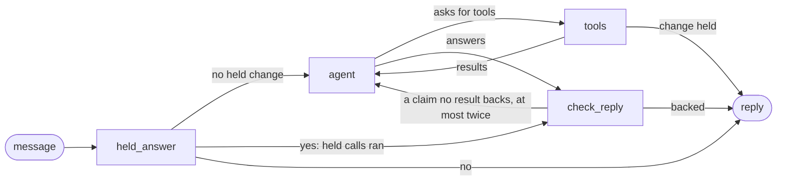

# The agent loop, and why it runs in LangGraph

The chat uses two things together. The **loop** is the technique: how the agent
thinks through a message. **LangGraph** is the frame: how that thinking is laid
out, saved and tested. This page says what each one does here, why it was
picked, what it costs, and what was turned down.

## The loop: the technique

The model gets the whole chat and the tools the person's role allows. Each step
it either answers, or asks for tools. The tool results go back to it as data,
and it takes another step. That repeats until it answers, inside a fixed budget:
4 model steps, 6 tool calls, 40,000 tokens and 90 seconds a turn.

**Why a loop.** The first version was a fixed pipeline: guess the intent, fill
the fields, plan the calls, write the reply. It broke on wording it did not
expect, and every new kind of question needed new code. The loop lets the model
choose its next step from the whole chat. The two were scored on the same 33
recorded conversations:

- The fixed pipeline passed 15 of 33.
- The plain loop passed 17 of 33.

**What the loop is not allowed to do.** The model never changes anything. When
it proposes a change (file a request, revoke access), code checks the
arguments, adds the idempotency key, saves the change on the chat and asks the
person in fixed words. Only the person's own yes, read by code, runs it. Access
decisions come from the policy engine through a tool, never from the model.
And every request number, role name and decision word in a reply must come from
this turn's tool results, or the reply goes back to the model.

## LangGraph: the frame

The loop runs as a LangGraph graph with four nodes:

- `held_answer`: when a change is waiting on the chat, code reads the person's
  yes or bare no. A yes runs the saved calls exactly as they were checked.
- `agent`: one model step, with the person's tools.
- `tools`: runs lookups and sends the results back to `agent`. A proposed change
  is checked and saved here, never run, and the turn ends with the question.
- `check_reply`: holds the reply to the tool results. A claim nothing backs goes
  back to `agent` with the reason, at most twice; then code writes the reply.

**Why LangGraph.**

- **Each part is a node you can see, test and swap.** The flow above is the
  code, not a drawing of it. A test reads the compiled graph and fails if a node
  or an arrow changes.
- **Every step is saved.** A Postgres saver keeps the state after each node,
  one thread per turn. A bad turn can be read back step by step: what the model
  saw, what it asked for, what came back.
- **It is the frame many production agents use**, so another engineer can read
  this agent without learning a home-made one.
- **It decides nothing.** LangGraph only moves the state between nodes. Access
  stays with the policy engine, and changes still run only on the person's yes.

The graph had to score at least as well as the plain loop on the same 33
conversations before it shipped:

- The loop in LangGraph passed 21 of 33.

The frame did not make the model smarter. The same steps run in the same order;
the number moved because the run is a sample of real model answers, so treat
it as "at least as good", not as a gain LangGraph gave.

## What it costs

- Three packages in the agent API: `langgraph`, its Postgres saver, and
  `psycopg` (the saver's own database driver; the rest of the app uses
  `asyncpg`).
- Saved-step rows in Postgres for each turn. `SAVE_TURN_STEPS=false` runs the
  same graph without saving.
- The graph is compiled once when the app starts, not per message.

## What was turned down

- **A plain loop with no framework.** It worked, and it is a few dozen lines.
  But the flow was hidden inside one class, nothing was saved, and a reviewer
  had to read all of it to see the shape. Keeping the technique and adding the
  frame gives the map and the saved steps for little cost.
- **Pausing a run until a manager approves.** LangGraph can stop a run and pick
  it up days later. The agent does not need it: a change waits on the chat as a
  saved question and the turn ends, and the person hears about a decision
  through notifications. No run is ever left waiting.
- **Going back to the old pipeline graph.** Only the frame came back, not the
  pipeline. Its nodes are gone, and a test fails if one returns.

## In two minutes

"The agent is a tool-calling loop: the model looks at the whole chat, calls
read tools, sees the results and decides the next step. I picked a loop over a
fixed intent pipeline because the pipeline broke on unexpected wording, and the
loop scored better on our recorded conversations. I run that loop inside
LangGraph so each part is a node I can test on its own, and every step is saved
to Postgres so I can replay a bad turn. LangGraph never decides anything: the
model can only propose a change, code holds it, and only the person's own yes
runs it, through typed tools behind role checks."
