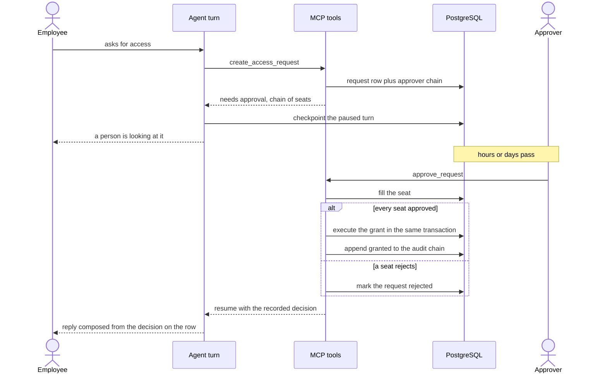

# Approval lifecycle

What happens to a request the policy engine sends for approval, and to the
conversation turn waiting on it.

Two properties the sequence is drawn to show.

The grant is made by the approval tool, in the same transaction as the last
filled seat. The resumed turn makes no tool call at all: it composes from the
decision recorded on the row, so a lost checkpoint cannot cost an approved
request its access.

A seat is filled by a person the segregation-of-duties rules allow to fill it.
One person cannot occupy two seats in the same chain.
