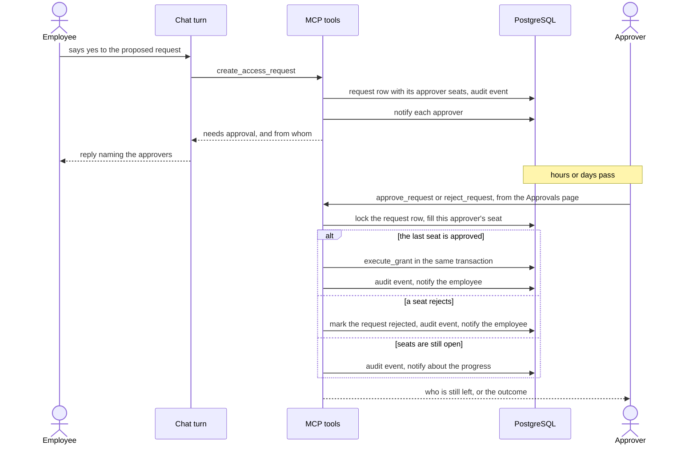

# Approval lifecycle

What happens to a request the policy engine sends for approval. The chat turn
does not wait. It ends with a reply that says who must approve, and the people
involved hear about each step through in-app notifications.

Three rules hold for every chain.

The grant is made by the approval tool, in the same transaction as the last
filled seat. No chat turn runs it, so a lost conversation cannot cost an
approved request its access, or grant it twice.

Nobody fills a seat on a request they made or are the target of. One person
fills at most one seat per chain, even when they hold two of the principals
the chain asks for.

Both decisions lock the request row first. Two approvers acting on the last
seat at the same moment cannot both grant.
