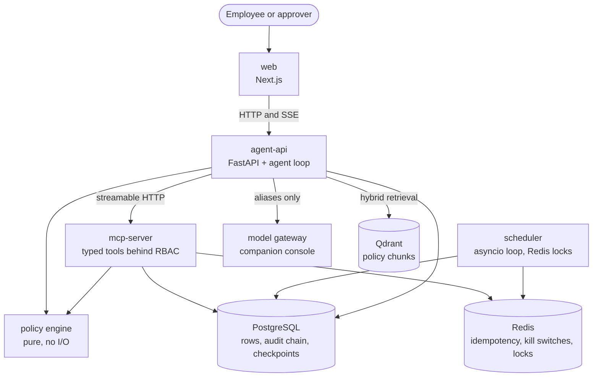

# Architecture

What runs, and what talks to what. The same diagram is embedded in the README.

Three properties are visible in the edges rather than in prose.

The model is reachable only from `agent-api`, and only through the gateway
under an alias. No service names a provider model.

Every write to PostgreSQL on a user's behalf arrives through `mcp-server`,
which authorizes the call against the caller's token before the handler runs.
`agent-api` writes only its own session and checkpoint rows.

The policy engine is a library, not a service. Both callers import the same
pure module, so the decision a tool enforces is the decision the turn
explained.
