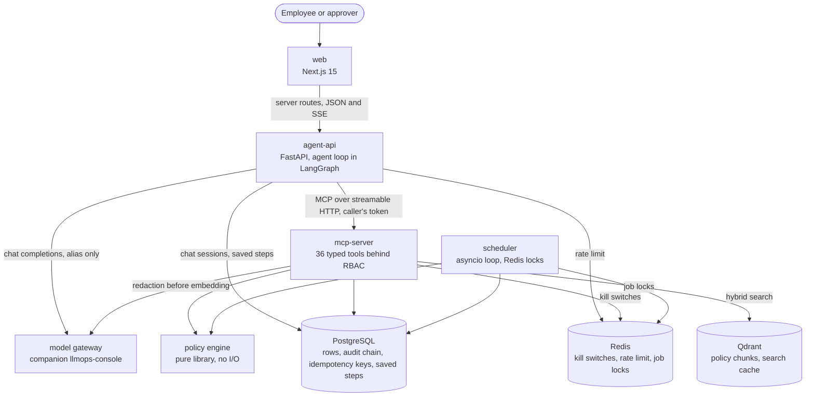

# Architecture

What runs, and what talks to what. The same diagram is in the README.

Three properties show in the arrows.

The chat model is reached only from `agent-api`, through the gateway, under an
alias. No service names a provider model. `mcp-server` also calls the gateway,
but only for redaction while it ingests policy documents.

Every change made on a person's behalf goes through `mcp-server`, which checks
the caller's token before the tool runs. `agent-api` writes only its own chat
session and saved-step rows, plus the audit event for a sign-in. The scheduler
writes directly for system jobs such as expiry and the leaver sweep, through
the same shared code the tools use.

The policy engine is a library, not a service. `mcp-server` and the scheduler
import the same pure module, so the decision a tool enforces is the decision
the reply explains.

Why the agent is a loop, and why it runs in LangGraph, is explained in
[docs/agent-loop-and-langgraph.md](../agent-loop-and-langgraph.md).
