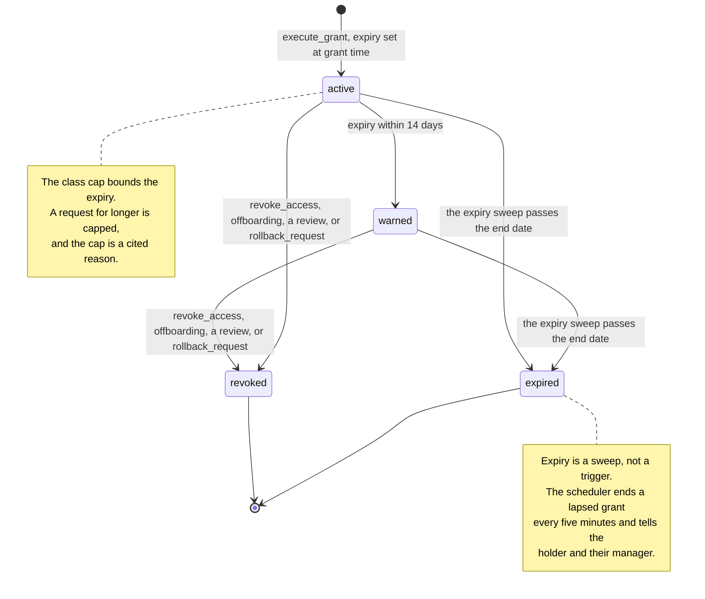

# Grant lifecycle

Every grant has an end date. There is no state in which access simply stays.

A grant row has three statuses, `active`, `expired` and `revoked`. `warned` is
not one of them. It is an `active` grant whose holder has been sent the
expiry warning. It is drawn because it is the state a holder notices.

Expiry is not a revocation. Nobody decided it, so the row keeps `revoked_at`
empty and only its status moves. A rollback by an IT admin, allowed within 24
hours of the grant, revokes the grant and marks the request `rolled_back`.
