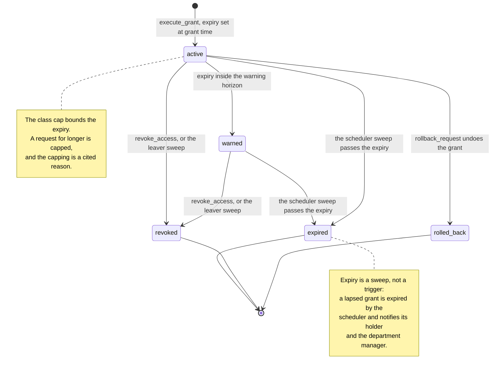

# Grant lifecycle

Every grant is time-bound. There is no state in which access simply persists.

`warned` is not a separate status in the database; it is an `active` grant
that has had its warning notification sent. It is drawn because operationally
it is the state a holder notices.
