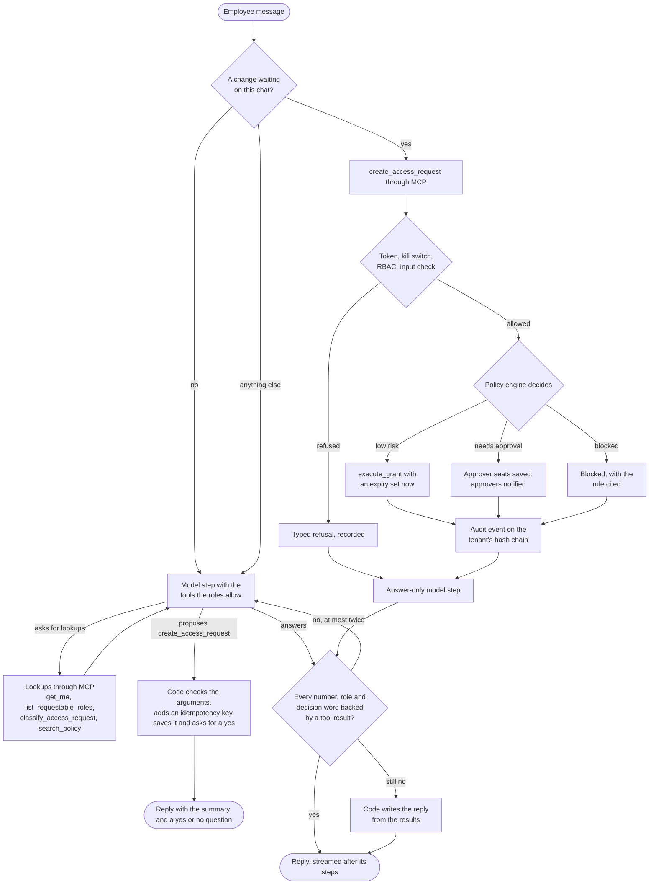

# Request lifecycle

One access request, from the employee's sentence to the reply they read. It
takes two chat turns. In the first the agent finds the role and proposes the
request. In the second the employee says yes and the request is filed.

The decision diamond is the policy engine, not the model. The model reads the
sentence at the top and writes the words at the bottom. The change in between
runs only on the person's yes, and it is checked, decided and recorded by
code.

`search_policy` refuses when the best passage scores below the threshold, and
the turn then offers a ticket instead of an answer from the model's memory.
