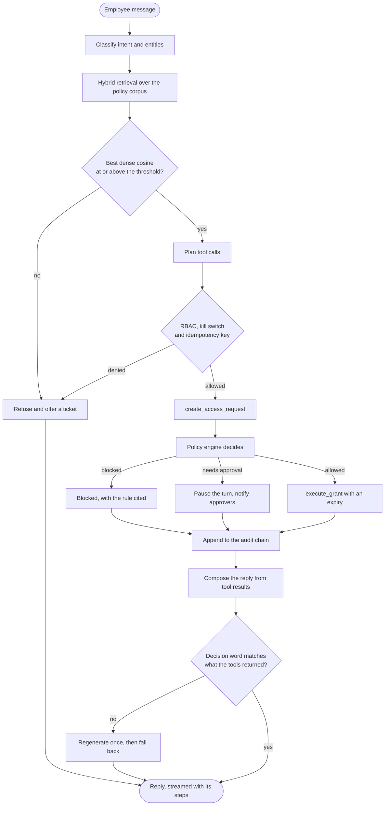

# Request lifecycle

One conversation turn, from the employee's sentence to the reply they read.

The decision diamond is the policy engine, not the model. The model reads the
sentence at the top and writes the words at the bottom; everything between the
two is deterministic, authorized and recorded.
